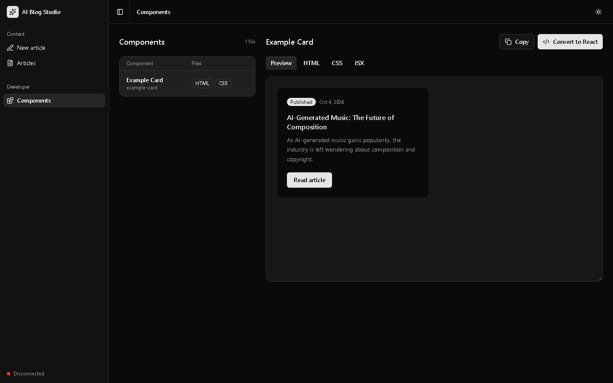

# Pages & Routes Reference

The project runs three apps. `npm run dev` in the project root starts all of them concurrently.

| App | Folder | Stack | Port | Script |
|-----|--------|-------|------|--------|
| API | `src/` | Express + Socket.IO | 3000 | `dev:server` |
| Admin (AI Blog Studio) | `frontend/` | React + Vite + shadcn-ui | 5173 | `dev:client` |
| Public site (AI Blog) | `site/` | Astro (server mode) | 4321 | `dev:site` |

For a user-facing walkthrough with screenshots, see [Pages Guide](../user/pages-guide.md).

---

## Admin (React Router) — `http://localhost:5173`

| Route | Component | Purpose |
|-------|-----------|---------|
| `/` | `pages/EditorPage.jsx` | New article: editor, AI generation, publishing, SEO metadata. Includes an Articles overview button. After AI generation saves an article, the admin returns to `/articles` and highlights the new row. |
| `/articles` | `pages/ArticlesPage.jsx` | Table of all articles (any status), sortable by title, status, or creation date, with open/delete actions; newly generated articles are scrolled into view and marked `Just created` briefly |
| `/articles/:id` | `pages/EditorPage.jsx` | Edit an existing article (`PUT` on save instead of `POST`); includes an Articles overview button |
| `/settings` | `pages/SettingsPage.jsx` | Configure the installed Ollama model and saved article-generation defaults |
| `/dev/components` | `pages/dev/ComponentsPage.tsx` | **Dev only.** Preview HTML/CSS files from `src/component-previews/`, view source, copy, convert to JSX. **New component** pastes a snippet and saves it to that folder. Left out of production builds. |
| `/login` | `pages/LoginPage.jsx` | Admin login (`ADMIN_USERNAME` / `ADMIN_PASSWORD` from `.env`); public route |

All other routes require a login (`components/ProtectedRoute.jsx`) and are wrapped in `components/layout/AppShell.jsx` (sidebar, header, theme toggle, AI status).

| Screen | Screenshot |
|--------|------------|
| `/` |  |
| `/articles` |  |
| `/articles/:id` |  |
| `/settings` | Settings uses the shared `AppShell` and theme; screenshot not captured yet. |
| `/dev/components` |  |

---

## Public Site (Astro) — `http://localhost:4321`

| Route | File | Purpose |
|-------|------|---------|
| `/` | `src/pages/index.astro` | Hero, featured article, latest articles, topics |
| `/blog` | `src/pages/blog/index.astro` | Article grid with search, in-place category filtering and pagination; displays animated loading placeholders during filter requests |
| `/blog?q=keyword` | | Search title/excerpt |
| `/blog?page=2` | | Pagination |
| `/blog/:slug` | `src/pages/blog/[slug].astro` | Article detail, reading time, related articles |
| `/category/:slug` | `src/pages/category/[slug].astro` | Articles in one category, including `/category/uncategorized` (supports `?page=`) |
| any unknown route | `src/pages/404.astro` | Not found (also used for unknown article/category slugs) |

Category slugs include `business`, `entertainment`, `finance`, `geopolitics`, `health`, `lifestyle`, and `technology`. The API also adds an `uncategorized` pseudo-category when published articles without a category exist.

| Screen | Screenshot |
|--------|------------|
| `/` |  |
| `/blog` |  |
| `/blog?q=music` |  |
| `/blog/:slug` |  |
| `/category/business` |  |
| 404 |  |

---

## API — `http://localhost:3000`

### Auth

| Method | Endpoint | Purpose |
|--------|----------|---------|
| POST | `/api/auth/login` | Body `{ username, password }`; returns `{ token, username }` (JWT, 24h) |

### Admin endpoints

All admin endpoints (including article publish/schedule and `/api/automation`) require an `Authorization: Bearer <token>` header and return 401 otherwise.

| Method | Endpoint | Purpose |
|--------|----------|---------|
| GET | `/api/articles` | List all articles |
| GET | `/api/articles/:id` | Get one article |
| POST | `/api/articles` | Create article |
| PUT | `/api/articles/:id` | Update article (auto-stamps `published_at` when status becomes `published`) |
| DELETE | `/api/articles/:id` | Delete article |
| GET | `/api/categories` | List categories |
| POST | `/api/categories` | Create category |
| DELETE | `/api/categories/:id` | Delete category |
| GET | `/api/settings` | Read saved AI model and writing defaults; includes installed Ollama models and connection status |
| PUT | `/api/settings` | Save `model`, `language`, `tone`, `audience`, and `articleLength`; model must be installed locally |
| POST | `/api/settings/check-model` | Run a short JSON-mode request against the selected installed model; unload it after the check and return the exact model response status |
| POST | `/api/ai/generate-article` | Generate an article with AI |
| POST | `/api/ai/suggest-topic` | Returns three distinct topic suggestions guided by optional `{ category, topic }` values from the Editor |
| POST | `/api/ai/suggest-slug` | Slug suggestions |
| GET | `/api/ai/status` | Active AI provider/model |

Settings endpoints require the admin JWT. Preferences are stored in the local, git-ignored `data/settings.json`; Ollama's installed model list is fetched from its `/api/tags` endpoint. The Settings screen currently exposes only Ollama and the writing defaults consumed by the Editor. The selected model is used for article generation, topic suggestions, and slug suggestions. The AI connection indicator checks whether Ollama is reachable; **Test selected model** separately verifies the draft selection with a JSON-mode completion before it is saved. Qwen3-family requests disable the model's default thinking phase so JSON output is returned directly.

Topic suggestions use the selected category and any text entered in the Topic field as context. The backend retries for missing suggestions and returns three distinct ideas or an error. Returned ideas are recorded for history. Shared admin buttons use a short pressed-state scale, brightness, and inset-shadow animation; asynchronous topic and slug suggestion actions also show a spinner while awaiting the API. Suggestion chips are width-constrained to avoid expanding the Editor sidebar.

The browser titles are `Blogstudio | Admin` for the management app and `Blogstudio | AI` for the public site. Public article cards show an `Uncategorized` badge when no category is assigned; the blog’s article count appears beside the category filters.

### Public endpoints (read-only)

Also mounted at `/blog` for backwards compatibility.

| Method | Endpoint | Purpose |
|--------|----------|---------|
| GET | `/api/public/articles` | Published articles; query: `page`, `limit`, `category` (slug), `q` |
| GET | `/api/public/articles/:slug` | One published article with related articles |
| GET | `/api/public/categories` | Categories with published article counts, plus `uncategorized` when applicable |

An article is publicly visible only when `status = 'published'` and `published_at <= now`.

---

## Regenerating Screenshots

Screenshots live in `docs/user/screenshots/` and are captured at 1440×900 in dark mode with Playwright (the Astro dev toolbar hidden). With all three apps running, capture each URL above with `page.screenshot()`; the home and article pages use `fullPage: true`.
