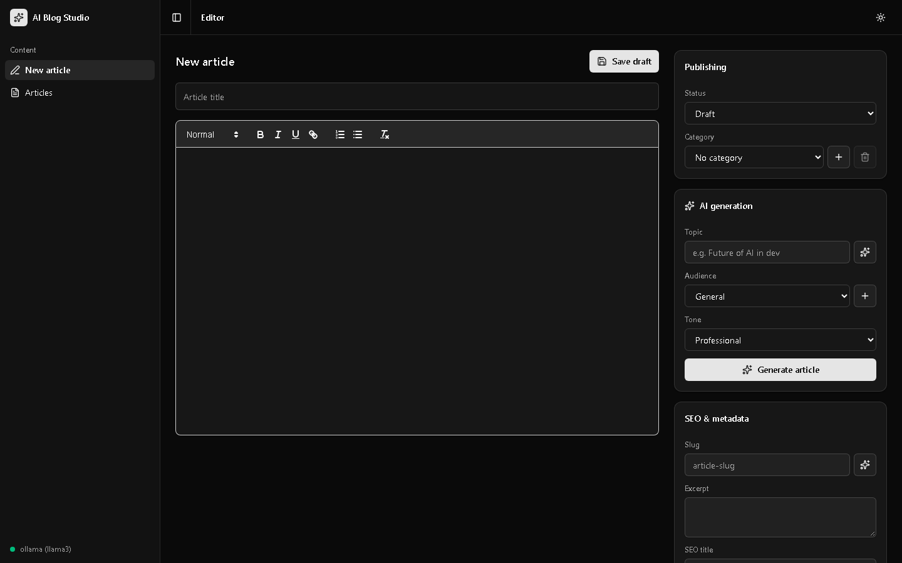
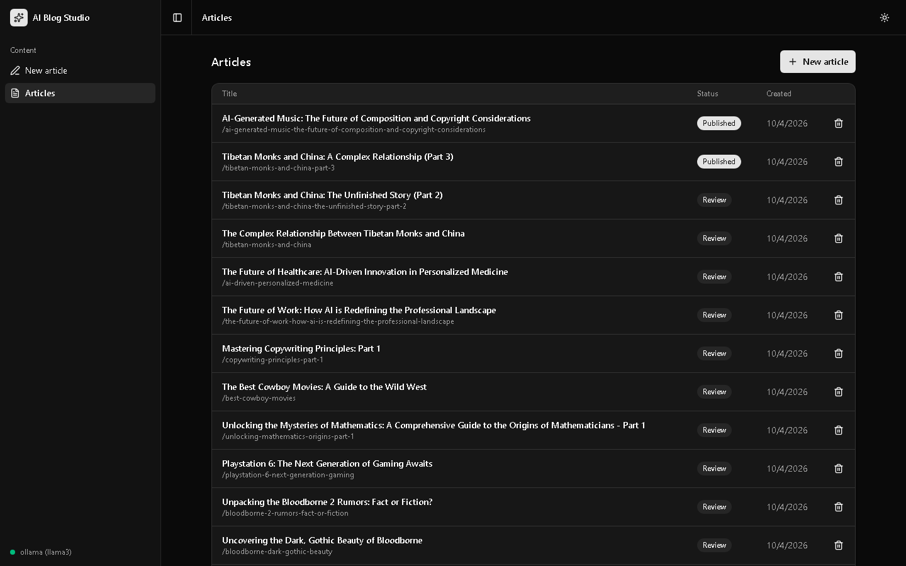
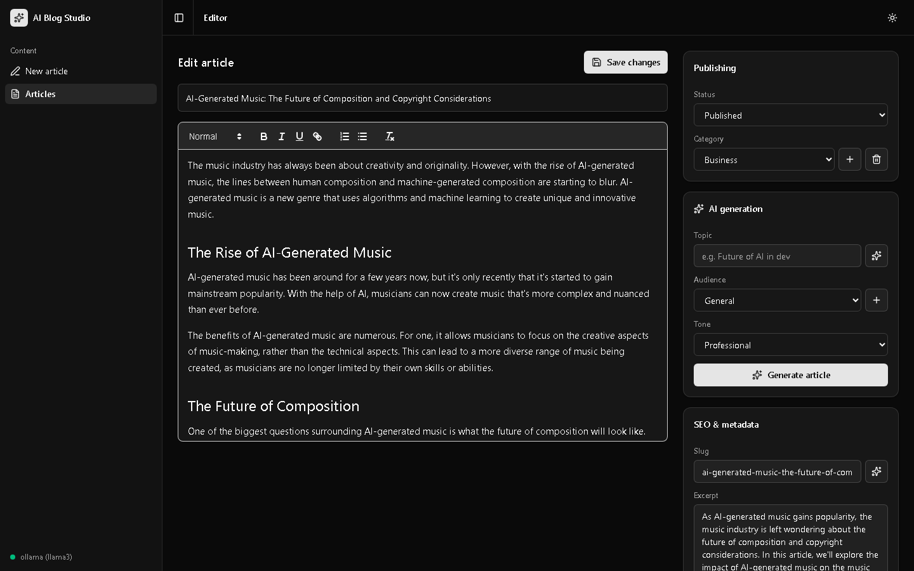
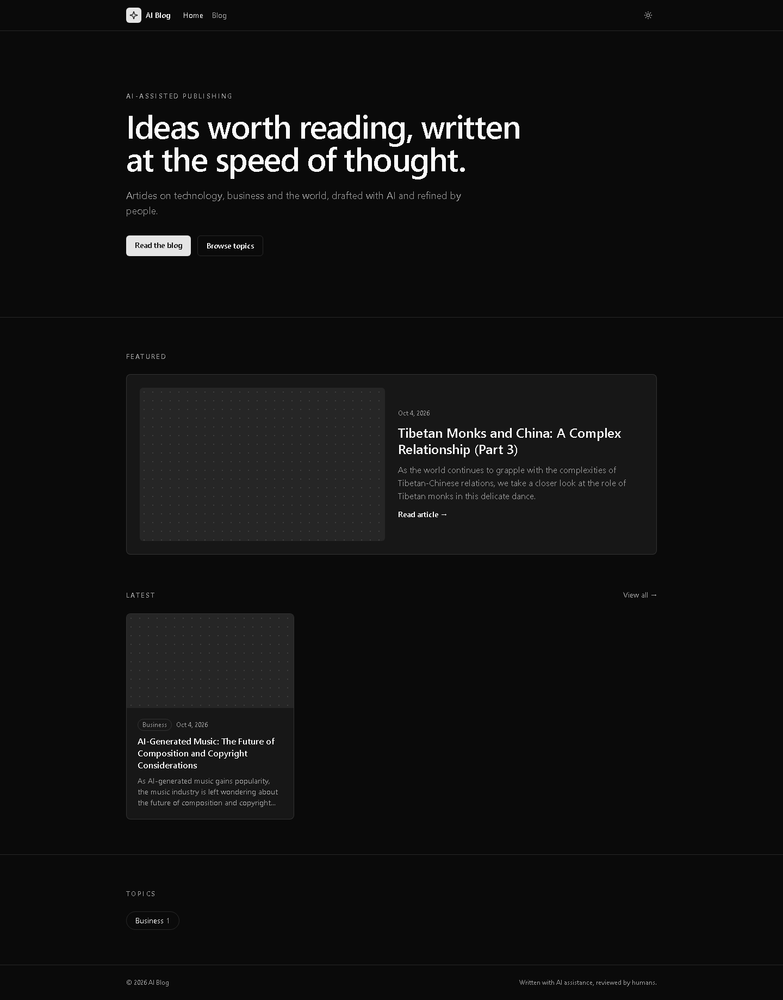
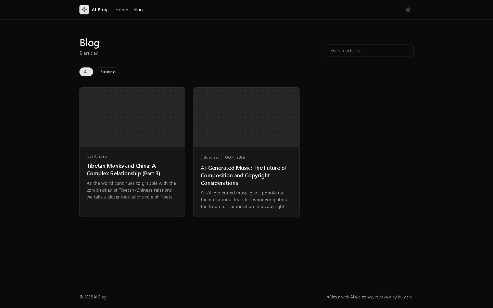
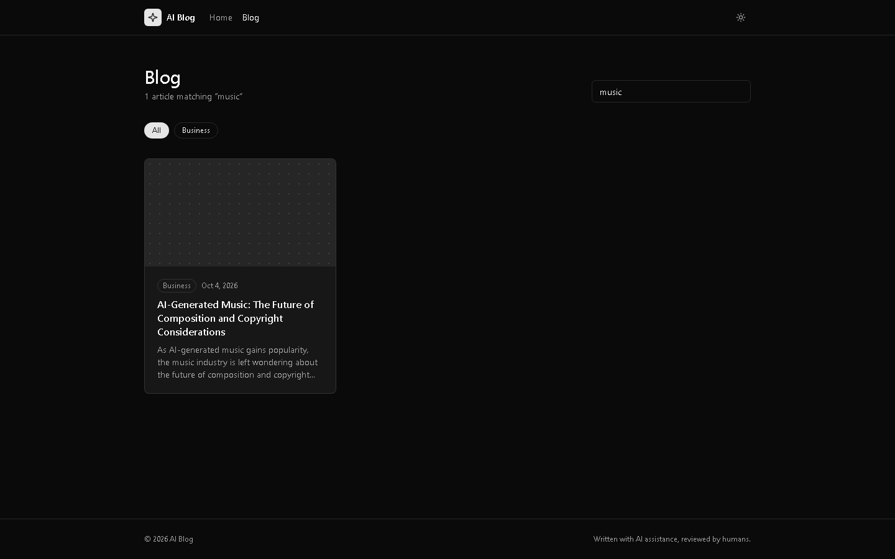
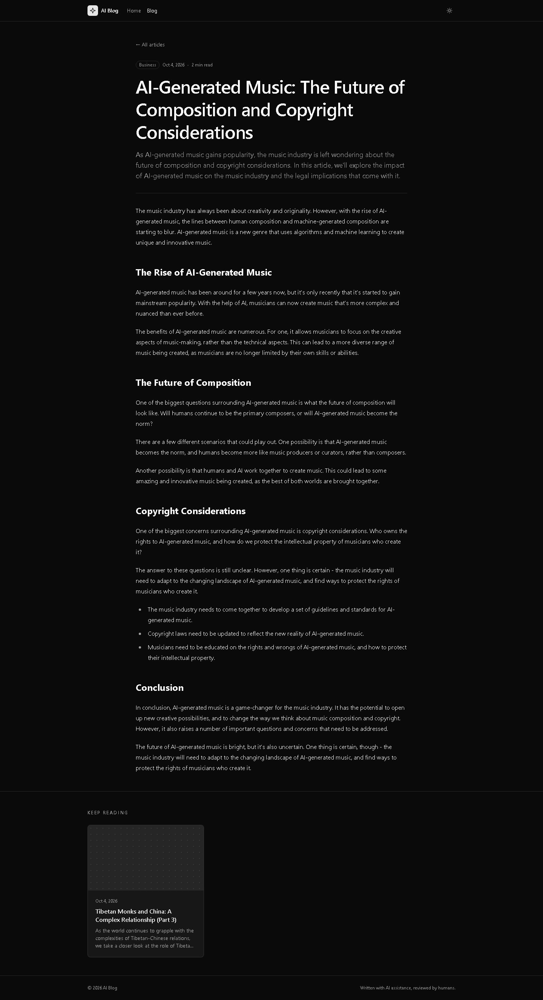
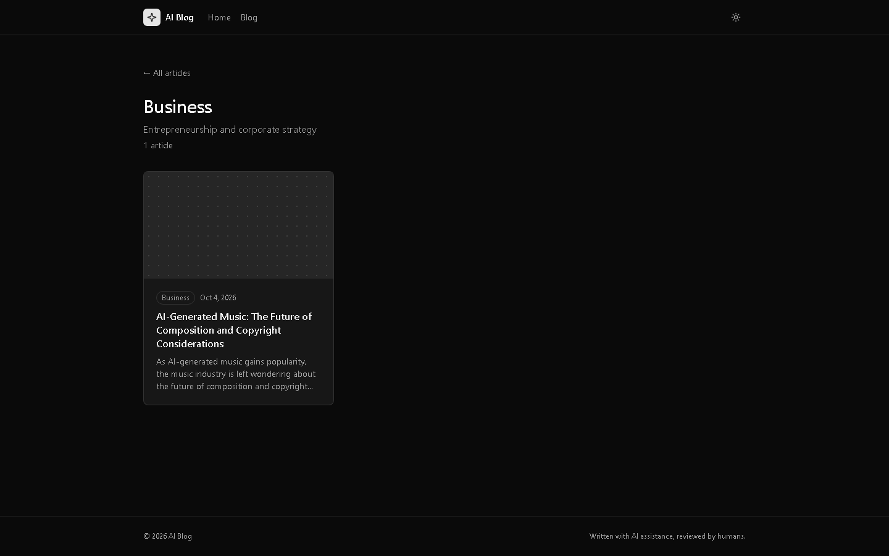
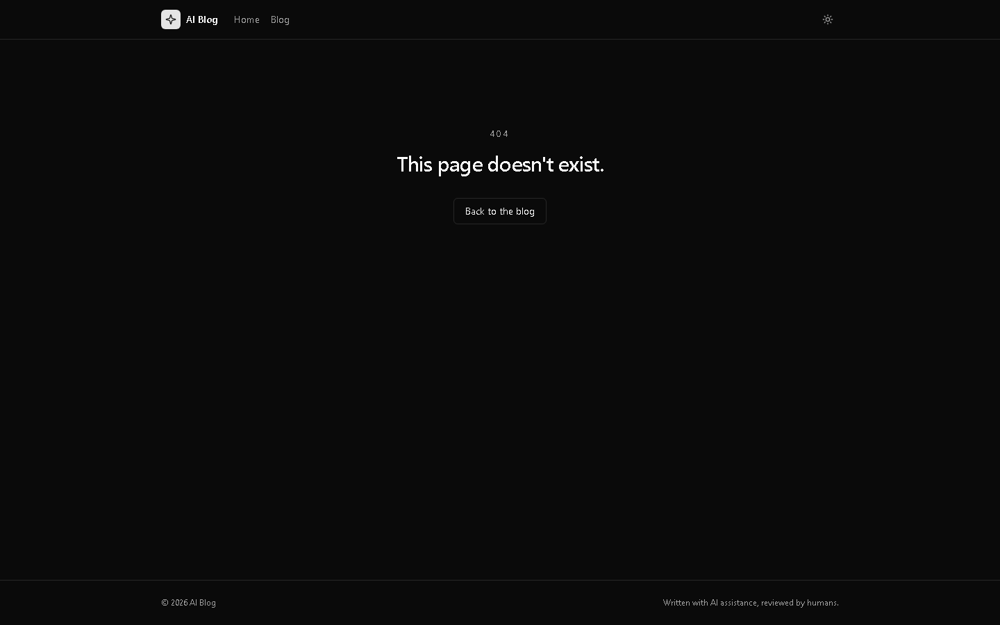

# Pages Guide

AI Blog consists of two websites:

- **AI Blog Studio** (admin): where you write, generate and publish articles.
- **AI Blog** (public site): where readers browse and read your published articles.

Start everything from the project root with:

```bash
npm run dev
```

| Website | Address |
|---------|---------|
| AI Blog Studio (admin) | http://localhost:5173 |
| AI Blog (public site) | http://localhost:4321 |

---

## AI Blog Studio (Admin)

### New article

**URL:** http://localhost:5173/

Write a new article or let AI generate one. Use the side panels to:

- **Publishing**: set the status (Draft, Review, Scheduled, Published, Archived) and category.
- **AI generation**: choose a category in Publishing to guide topic suggestions, or leave it blank for free-form ideas. Enter a topic (or click the sparkle button), choose an audience and tone, then click **Generate article**.
- **SEO & metadata**: set the slug (the article's web address), excerpt, SEO title and SEO description.

Click **Save draft** to save the article.



### Articles Overview

**URL:** http://localhost:5173/articles

The Articles section of the sidebar contains **Articles Overview** and **Articles Analytics**. The overview lists all articles with status, category, and creation date. Click a sortable column heading to change the order. Unpublished statuses and uncategorized rows can be edited inline; only the article title opens the editor. Use the trash icon to delete an article, or **New article** to start one.



### Articles Analytics

**URL:** http://localhost:5173/articles/analytics

View article totals, publishing activity for the last six months, published content by category, topic and SEO keyword coverage, and reader views and active reading time for the selected 7-, 30-, or 90-day period. Estimated reading time is calculated from article length and is shown separately from measured reader time. Public reader tracking starts when this version is deployed; historical visits are not available.

### Edit article

**URL:** http://localhost:5173/articles/{id}

Opens an existing article in the editor. Make your changes and click **Save changes**.

In **Featured image**, upload a JPG, PNG, WebP, or GIF (up to 12 MB), or select an existing library image. Enter a photo credit/source, such as the photographer's name, below the preview. It appears in a small caption beneath the image on the full article page after you save the article, not on article cards. AI image generation will be added later.



### Media Library

**URL:** http://localhost:5173/media

Upload images and reuse them across articles. Add or update a photo credit/source beneath each library preview; the saved credit appears under the featured image on full article pages. Images assigned to an article must first be removed from that article before they can be deleted. Files are stored on the Blogstudio server.

---

## AI Blog (Public Site)

> Only articles with the status **Published** appear on the public site.

### Home

**URL:** http://localhost:4321/

The landing page with a featured article, the latest articles and a list of topics.



### Blog

**URL:** http://localhost:4321/blog

All published articles. You can:

- **Search**: type in the search box, e.g. http://localhost:4321/blog?q=music
- **Filter by category**: click a category button to update the article list in place. An animated placeholder appears while results load. If published articles have no category, an **Uncategorized** filter appears. Articles without a category show an **Uncategorized** badge on their cards.
- **Browse pages**: use the page buttons at the bottom, e.g. http://localhost:4321/blog?page=2





### Article

**URL:** http://localhost:4321/blog/{slug}

The full article with its category, publish date and estimated reading time. Related articles are shown under **Keep reading**.

Example: http://localhost:4321/blog/ai-generated-music-the-future-of-composition-and-copyright-considerations



### Category

**URL:** http://localhost:4321/category/{slug}

All published articles in one category, e.g. http://localhost:4321/category/business

Available categories: `business`, `entertainment`, `finance`, `geopolitics`, `health`, `lifestyle`, `technology`.



### Page not found

Shown for any address that doesn't exist, e.g. http://localhost:4321/does-not-exist



---

## Publishing an Article

1. Open http://localhost:5173/articles and click the article you want to publish.
2. In the **Publishing** panel, set **Status** to **Published**.
3. Click **Save changes**.
4. Visit http://localhost:4321/blog — the article is now live.

The publish date is set automatically the first time an article is published.

## Light and Dark Mode

Both websites have a sun/moon button in the top-right corner to switch between light and dark mode. Your choice is remembered.
